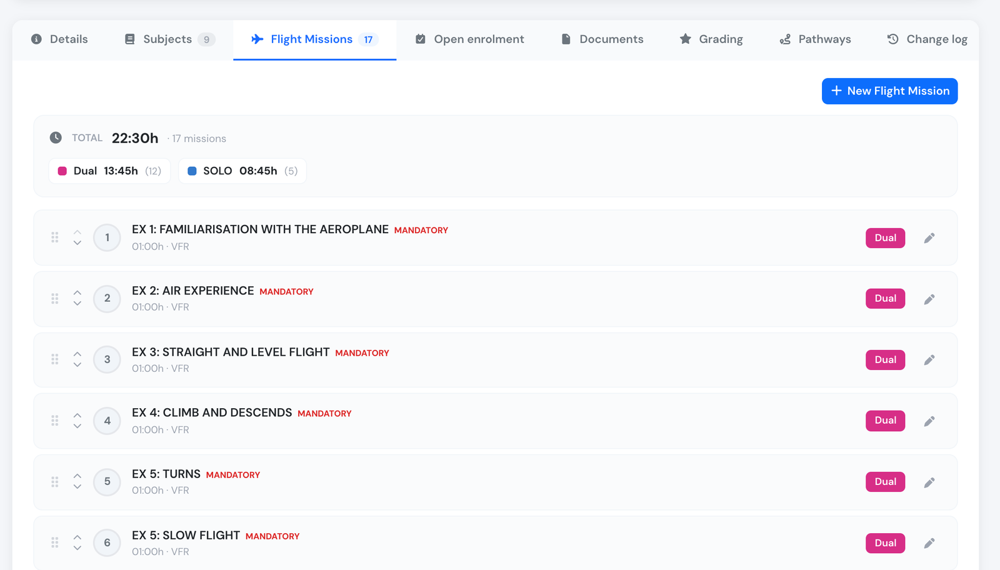
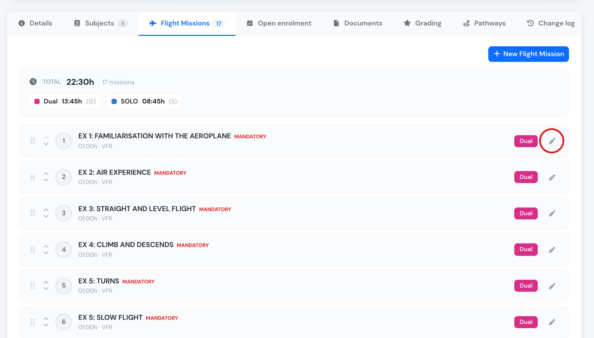
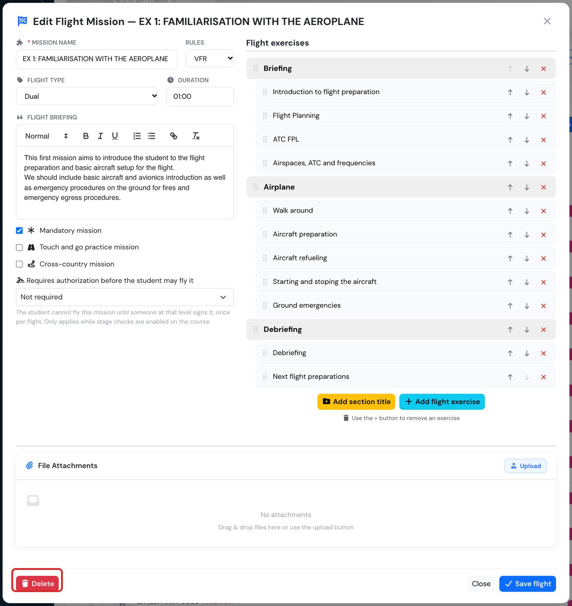

# Flight Training

If you have activated the Flight Training Missions checkbox in your training edit page, you will have now an additional tab in the main training page.

Once you have created the flight missions for your training, you will be prompted to enter the mission results for each student when creating a flight.

<figure><figcaption>
New Flight Training missions tab
</figcaption></figure>

### Edit Flight missions

The flight missions are categorized by flight rules, flight type and time. They can be ordered as you need to by just dragging the missions up and down.

To create a new mission, just click on the **+ New Flight Mission** button. If you chose to edit an existing one, the same form will pop but it will be populated with the existing mission data.

A third option exists to Copy an existing mission, when clicking the COPY button, a new copy of the original mission will be created at the end of the missions list.

<figure><figcaption>
List of flight missions in a flight training
</figcaption></figure>

The form to create/edit flight missions is really straight forward and allows you to manage the basic information about the mission on the left, and  you can organize all the required mission exercises on the right side.

<figure><figcaption>
Form to edit a flight mission
</figcaption></figure>

### Delete a flight mission

1. Open the course and go to the **Flight Missions** tab.
2. Click the pencil icon on the mission's row to open it.
3. Click **Delete** at the bottom left of the mission editor.
4. Confirm with **Yes, delete it!**

<figure><figcaption>
Open the mission with the pencil icon on its row.
</figcaption></figure>

<figure><figcaption>
The Delete button is at the bottom left of the mission editor.
</figcaption></figure>

#### Who can delete a mission

Only Company Administrators, Operations Managers, Compliance & Safety Managers, Human Resources Managers, Financial Managers and Trainings Managers see the **Delete** button. Instructors, Chief Pilots and other roles can open the mission but cannot delete it. This applies even when they manage the course.

#### A mission that has been flown cannot be deleted

Once any student has flown the mission, meaning a flight has been recorded with it, the **Delete** button no longer appears. This keeps every student's training record complete. The mission becomes deletable again only if it is removed from every flight it was recorded on.

If you need to stop using a mission that has already been flown:

* **Untick Mandatory mission** if students should no longer have to fly it to complete the course. The mission and its past results stay on record.
* **Start a new course revision** (see [Course revisions](edit-a-training.md#course-revisions-minor-and-major-changes)) and delete the mission there. The new course revision has its own copy of each mission, so you can delete a mission there as long as nobody has flown it in that revision. Students on the current revision keep the mission until you move them.

#### What deleting a mission does

* **The mission is removed from the course right away**, for everyone. That includes its exercises and the files attached to it. It no longer appears in the mission list, in the student's training progress, or in the mission list on the flight form.
* **The course's total planned time and mission count are updated** to leave it out.
* **Bookings already made for that mission lose it.** The booking keeps its date, aircraft and crew but no longer shows a mission. Choose another mission on the booking if the slot should still count for training. A booking dispatched after the deletion creates a flight with no mission on it.
* **The deletion is recorded in the course's Change log** with your name and the date. It opens a course revision that needs approval, like any other change to the course's missions (see [Course Approvals](course-approvals.md#approving-content-changes)).

#### Undoing a deletion

The confirmation message says the deletion cannot be reverted, but an approver can use **Undo** on the deletion entry in the **Change log** tab (see [Undoing a change](course-approvals.md#undoing-a-change)). This restores the mission with its name, flight type, planned time, flight rules, stage, flags and briefing.

**Undo does not bring back the mission's exercises or attached files.** These are deleted together with the mission. After an undo, add the exercises again and upload the files again. Before deleting a mission with a long exercise list, check that you really want to remove it.

### Evaluate Flight missions

<figure><figcaption>
Flight mission evaluation when entering a flight into the logbook
</figcaption></figure>

> When adding a flight, if both the Pilot-In-Command (PIC) and Second-In-Command (SIC) are enrolled in any training, you will see boxes that allow you to select which exercises they performed on that particular flight. This feature enables you to evaluate each pilot individually.

After the flight is confirmed, the flight time will be added to the training reports of both pilots and included in their training flight time.

#### Multiple missions

You can have multiple missions per flight, and multiple flights for each mission. This can be done for any of the crew members of the flight.

Single flight, multiple missions example:

<figure><figcaption>
Multiple flight mission evaluation for a single student pilot
</figcaption></figure>

Also, you can have the same mission, repeated as many times as needed in following flights. In this case, all repetitions will appear in the training report of the pilot:

<figure><figcaption>
Flight mission training progress for a student pilot
</figcaption></figure>

### Gating progression

By default a student may fly the missions of a course in any order. Two optional controls change that, both switched on per course and both off by default:

* [**Stage Checks**](stage-checks.md) — group missions into ordered stages, each ending in a check the student must pass before flying the next stage.
* [**Mission Authorizations**](mission-authorizations.md) — require an individual signature before a student may fly a particular mission, such as a first solo under EASA FCL.020.
