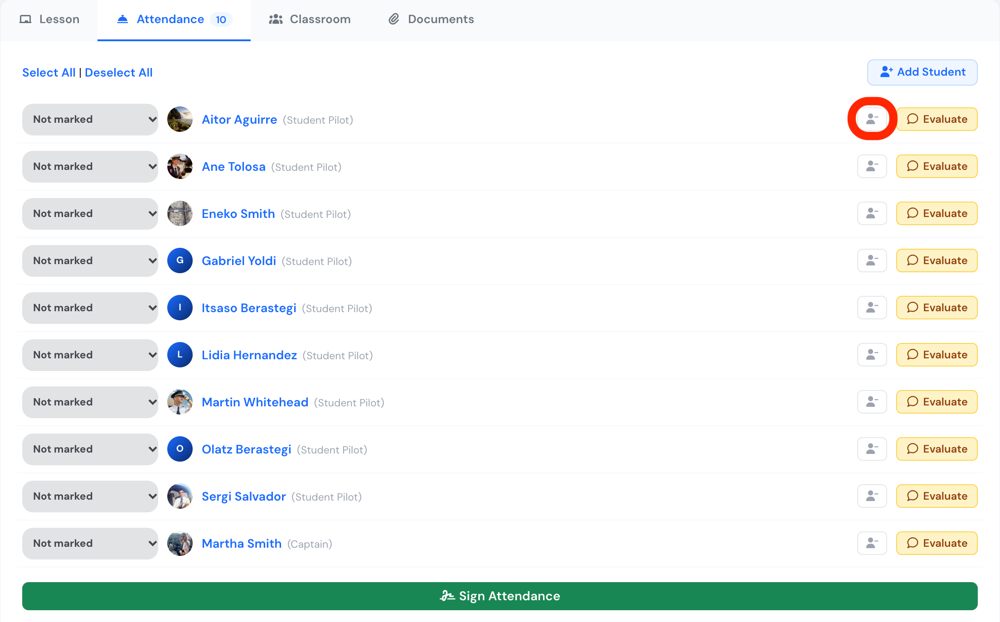
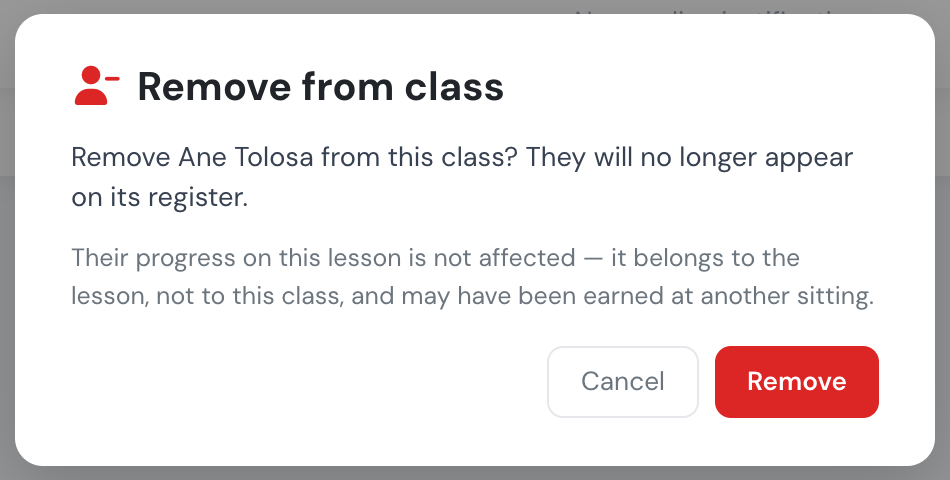

# Schedule a class or an exam

Flylogs provides you with tools for the entire training cycle, including daily lessons for students.&#x20;

With Flylogs, you can easily schedule these classes, select the teacher and students, and notify everyone at once. The process is simple and fast, and the teacher has instant access to manage the scheduled classes and upload relevant content. Similarly, students have access to the scheduled lessons, where they can read class content, view published descriptions, and download uploaded documents.&#x20;

Additionally, a comment box is available, which can be enabled or disabled, and is useful for students who may have questions.

### Student exam results and attendance records

As part of the scheduled lesson management, the teacher or any manager, can access to the class, and mark the students that attended the class.

This records are stored in the student's academic profile as part of the training progress.

### Add or remove students after scheduling

You can change who is on a class after you schedule it. Open the class and go to the **Attendance** tab.

* **Add Student** (top right) adds another enrolled student to the class. Teachers and managers can do this.
* The **remove icon** (a person with a minus sign) next to **Evaluate** on each student's row takes that student off the class. Only managers and the training office can see it. Teachers cannot.

<figure><figcaption>
The Attendance tab. The remove icon is on each student's row, just left of <strong>Evaluate</strong>.
</figcaption></figure>

Click the remove icon, then click **Remove** to confirm. The student no longer appears on the class register.

<figure><figcaption>
Confirming the removal.
</figcaption></figure>

Removing a student from a class does **not** remove them from the course and does not change their progress on the lesson. Progress belongs to the lesson, not to one class, and the student may have completed the lesson in another class. To take a student out of the whole course, change their enrolment from **Trainings → Students**.


You can only remove a student while the class register is still open. The remove icon is hidden on a student's row when any of these is true:

* attendance has already been marked for that student (anything other than **Not marked**),
* the student has signed their attendance for the class,
* the attendance register has been signed, or the class is closed or cancelled.

So if you add someone by mistake, remove them **before** you mark attendance or sign the register. If the register is already marked or signed, contact support and we will correct the class for you.





Class work (homework) isn't requested when scheduling a class — it's requested afterwards, from the class page's **Classroom** tab. See [Missed classes and class work](missed-classes-and-class-work.md).



The sessions of the next 7 days, and their class pages, are kept on your device, so you can still check them without a connection. See [Schedules and classes offline](../schedules/offline-schedules-and-classes.md).

