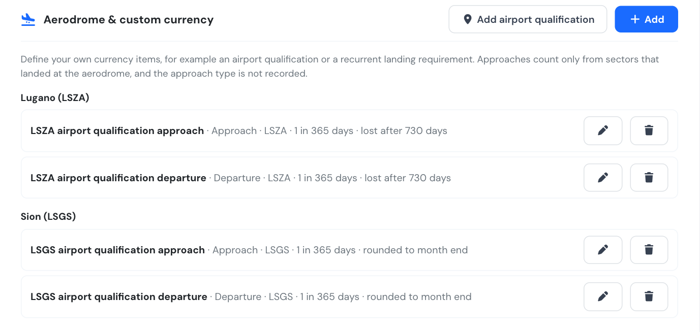
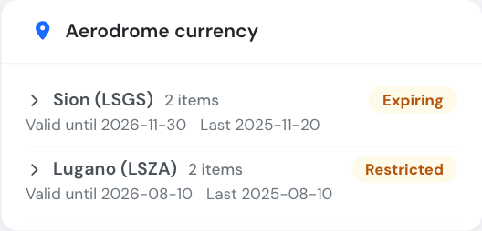

# New: aerodrome and custom currency

**November 2026** · Crew management

Some airports ask for more than a valid licence: a recent IFR approach and departure at Sion, a recent approach at Lugano. You can now define these requirements yourself, and Flylogs tracks them from the flight log.

***

### Define your own currency items

In **Company Settings → Flight Crew → Aerodrome & custom currency**, **Add airport qualification** creates the usual pair for an aerodrome: an IFR approach and an IFR departure within 12 months, valid to the end of the month. For anything else, **Add** lets you choose the event, aerodrome, flight rules, seat, period, minimum count, month-end rounding, a **Lost after** limit and the warning days. Items with the same group label form one qualification: every item must be met, and the worst status wins.

<figure><figcaption>
Sion and Lugano, set up as groups of two items.
</figcaption></figure>

Flylogs counts sectors that landed at, or departed from, the aerodrome in confirmed flights. Missed approaches and the approach type are not recorded, so they cannot be counted. Every crew seat earns the credit.

***

### See it where it matters

Each pilot gets an **Aerodrome currency** card with a status (Valid, Expiring, Restricted, Expired, Lost or Not qualified) and the date it is valid until. A booking that touches an aerodrome shows a warning for any crew member whose item for it is not valid. The pilot is also emailed when an item starts to expire.

<figure><figcaption>
The pilot's card: Sion expiring, Lugano restricted.
</figcaption></figure>

***

### Block pilots who are not current

**Block pilots that do not meet established currency** now really blocks. When it is on, a PIC whose currency levels are not met, or whose item for the aerodromes of the flight is Expired, Lost or Not qualified, cannot be booked or have a flight confirmed. Expiring and Restricted only warn. An instructor as supervisor allows a requalification flight, and staff from Company Administrator to Flight Dispatcher can still confirm a flight that already took place (Chief Pilots and crew cannot).

Available on the Premium and Unlimited plans (trial included). Only Company Managers with access to Company Settings can edit the items; pilots see their own status.

***

See [Pilots settings](../company-management/company-settings/pilots.md#aerodrome-and-custom-currency), [Pilot currency checks](../crew-management/pilot-currency-checks.md) and the [Currency items API](../API/reference/currency-items.md).
