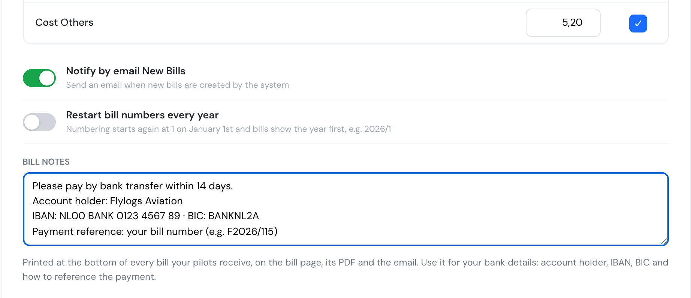
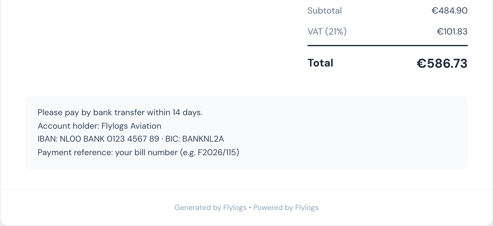

# New: bank details on every bill

**November 2026** · Billing

Customers who pay by bank transfer can now find your bank details on the bill itself. Add them once in **Company → Settings → Billing → Bill notes** and Flylogs prints them on every bill.

***

### Write it once

**Bill notes** is a free-text field under the billing defaults. Put whatever your customers need to pay you: account holder, IBAN, BIC, payment deadline, and what to use as the transfer reference. Line breaks are kept.

<figure><figcaption>
Bill notes in the billing settings.
</figcaption></figure>

***

### On every bill, PDF and email

The text appears at the bottom of every bill page and in its PDF download. The new-bill email shows it under **Payment information**. It applies to bills already issued too, so a new bank account shows up everywhere straight away.

<figure><figcaption>
Your bank details under the bill totals.
</figcaption></figure>

Each bill already has its own number (for example `F2026/115`), which makes a good payment reference.

Only company managers can edit the notes. Pilots and clients see them on their own bills.

***

See [Billing settings](../company-management/company-settings/billing.md#bill-notes) for the full reference.
