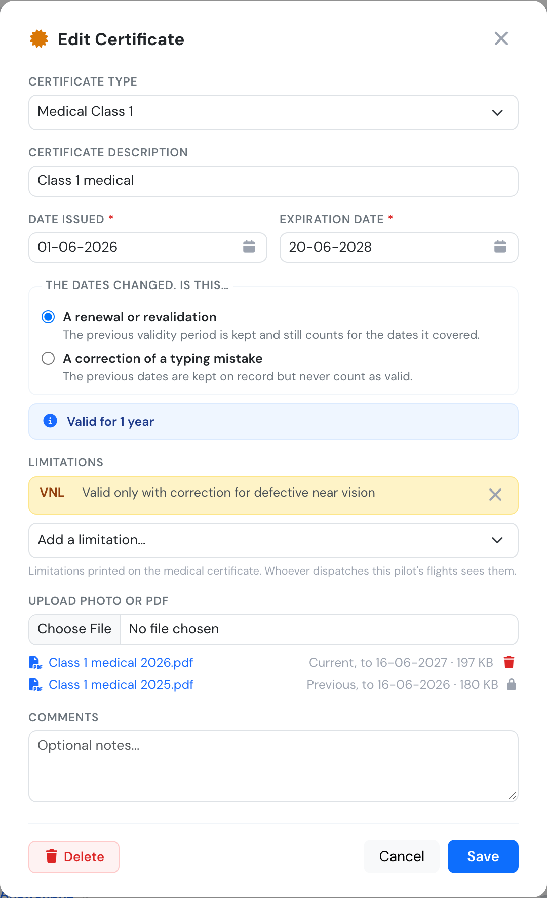
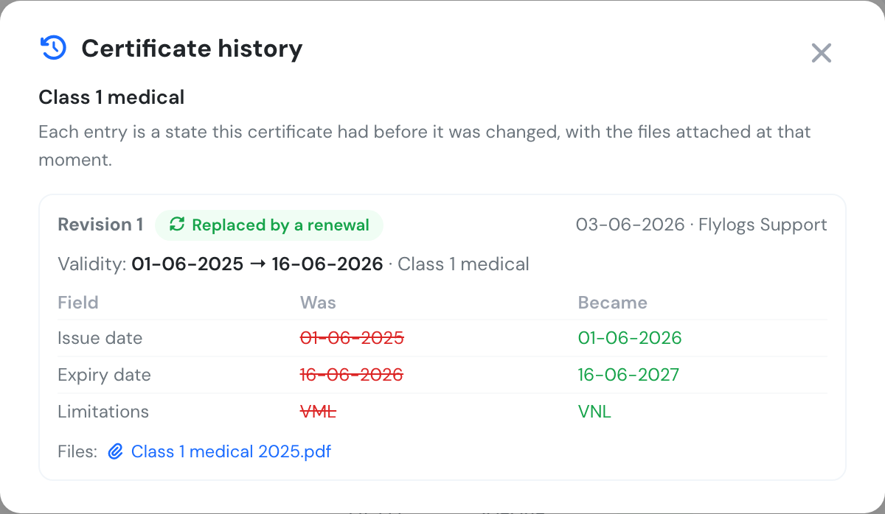

# New: Certificate history, files by period and certificates on a date

**November 2026** · Crew management

Renewing a crew certificate no longer overwrites what it was. Flylogs now keeps every earlier state of a certificate as a dated revision, labels each file with the validity it was filed against, and can show anyone's certificates as they stood on a past date.

***

### Why we built it

A certificate is a single record: renewing a medical or accepting a revalidated rating from a licence reading updated that record in place, and the previous validity period was gone. An approved training organisation has to keep the expiry dates of its students' licences, ratings and medical certificates for the whole course and three years after it (ORA.ATO.120), and has to be able to show what someone held on a given day.

***

### How it works

* **Revisions.** When the dates, type, description, status, comments, medical limitations or aircraft covered of a certificate change, the previous values are kept as a revision: what each field was and became, the files attached at that moment, who changed it and when. Deleting a certificate keeps its last state and its files too.
* **Renewal or correction.** When the dates of a certificate already on file change, the form asks whether it is a renewal or the correction of a typing mistake, pre-selected from the dates. A renewed period still counts for the dates it covered; corrected dates are kept on record but never count as valid.

<figure><figcaption>
Renewing a medical: the form asks whether the new dates are a renewal or a correction.
</figcaption></figure>

* **Every file, with its period.** All files of a certificate are kept, not only the newest, behind a files button with their number. Each is labelled *Current* or *Previous* with the expiry it was filed against. A file attached before this update reads *period not recorded* with its upload date, and a manager can enter the period it covers. Files of a previous period are locked; a company setting keeps the files whose period was not recorded too.
* **History button.** A certificate with earlier revisions shows a history button with their number. It opens the revisions newest first, with the old and new value of each field.

<figure><figcaption>
The previous period of a Class 1 medical, replaced by a renewal.
</figcaption></figure>

* **Certificates on a date.** The pilot audit tool has a **Certificates on** field: pick a day to see each person's certificates as they stood then, with remaining days counted from that day. The API answers the same per person with `GET /pilots/certificates/{userId}.json?on=YYYY-MM-DD`.

<figure><figcaption>
On 22 December 2025 the Class 1 medical was the previous period, valid to 16 June 2026.
</figcaption></figure>

History starts with the first change made after this update. Values overwritten before then cannot be recovered.

The history is visible to everyone who can see the certificate. Medical limitations in it are shown only to the certificate holder and to user groups 170 and below (managers, Chief Pilot, Flight Instructors). External auditors see the history but cannot open the files. The pilot audit tool is available to company managers.

[Manual →](../crew-management/document-and-certificates.md#renewals-and-certificate-history)
