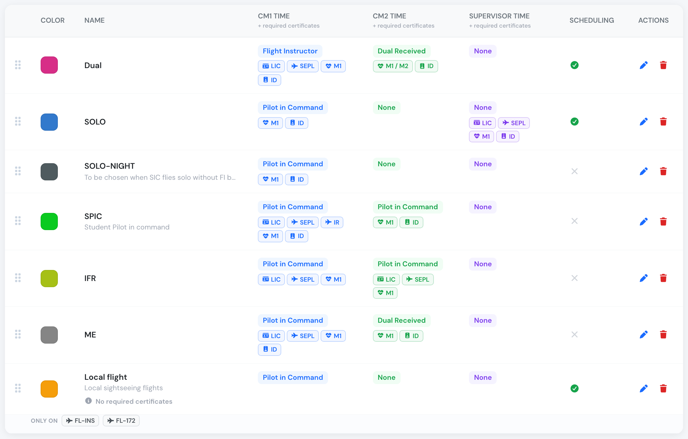
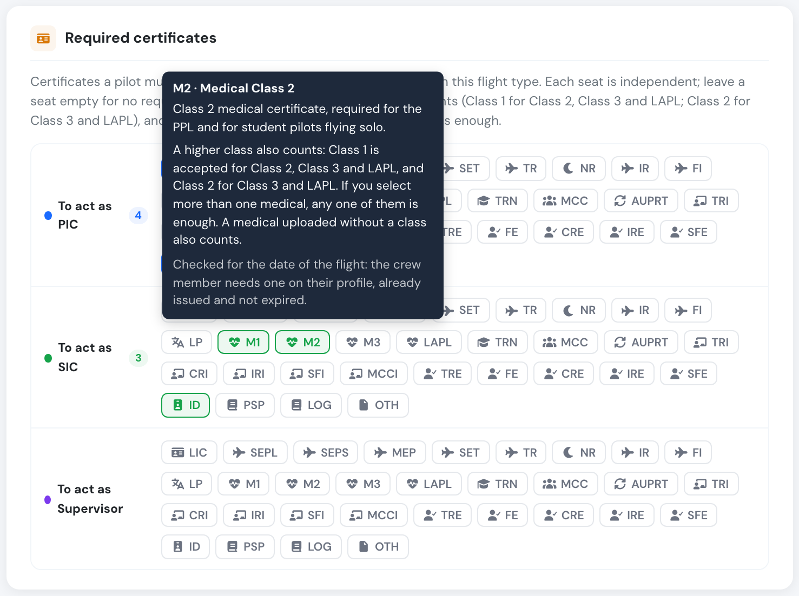
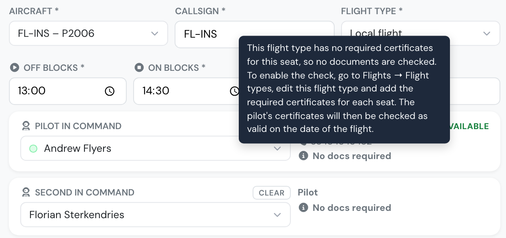
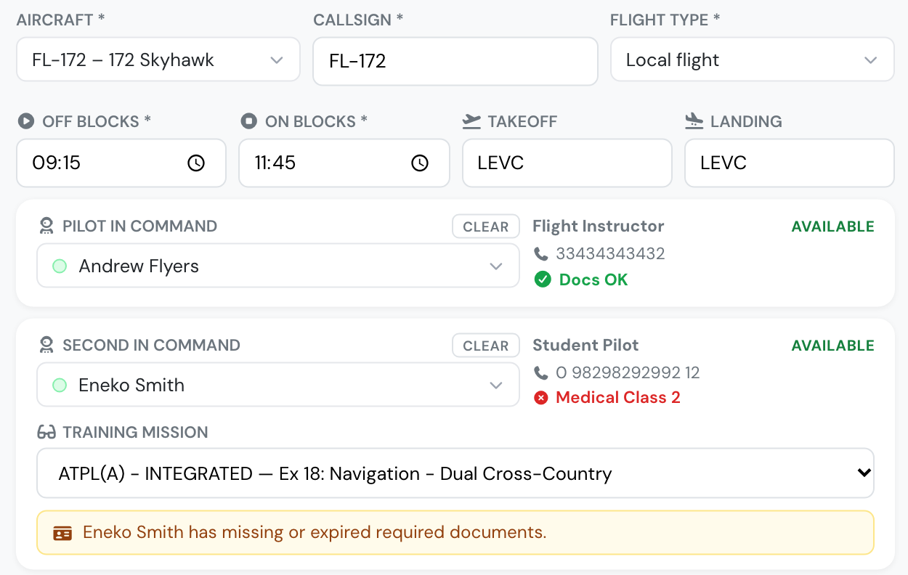
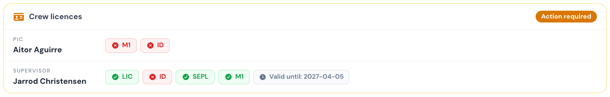

# Crew document checks follow your flight types

**November 2026** · Schedules & Dispatch

Flylogs checks crew documents against the certificates **you list on each flight type**. A flight type with no list has nothing to check, so please review yours. Medical checks also got simpler: a higher class now counts.

***

### Check your flight types

Open **Flights → Flight types**. Each seat's required certificates appear under that seat's column, and a type with none says *No required certificates*.

<figure><figcaption>
<em>Local flight</em> has no required certificates, so its crew are not document-checked.
</figcaption></figure>

Open a type and pick what each seat must hold. Hover any certificate to see what it is.

<figure><figcaption>
Each certificate explains itself when you hover it.
</figcaption></figure>

***

### What you see on the schedule

On the crew card, a grey **No docs required** replaces the green *Docs OK* when the flight type lists nothing for that seat. Green *Docs OK* now always means a real check passed.

<figure><figcaption>
Hover the label to see how to switch the check on.
</figcaption></figure>

***

### Medicals: a higher class counts

* A seat requiring **Class 2** also accepts a **Class 1**.
* A seat requiring **Class 3** also accepts a **Class 2** or **Class 1**.
* A seat requiring a **LAPL medical** also accepts a **Class 2** or **Class 1**.
* If you select **more than one** medical for a seat, any one of them is enough.

A seat requiring **Class 1** still accepts only a Class 1. This applies on the schedule, the dispatch briefing, the flight form and self-booking warnings.

<figure><figcaption>
A Class 1 meets the PIC's Class 3 requirement. A Class 3 does not meet the SIC's Class 2 requirement.
</figcaption></figure>

***

### Checked at the date of the flight

Every crew check now uses the flight's date and time, including the dispatch briefing and the flight form. A flight logged late is no longer flagged for a medical that has expired since, and a booking after a medical's expiry shows it as expired.

<figure><figcaption>
A November booking: this M1 expired in October, so it is red.
</figcaption></figure>

***

### New companies

Companies signing up from now on start with a licence and a Class 1 medical required on the PIC seat of every starter flight type. Adjust them to suit your operation.

[Read the flight types manual →](../flights/flight-types.md#required-certificates)
