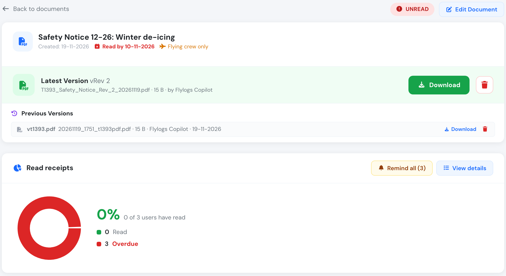
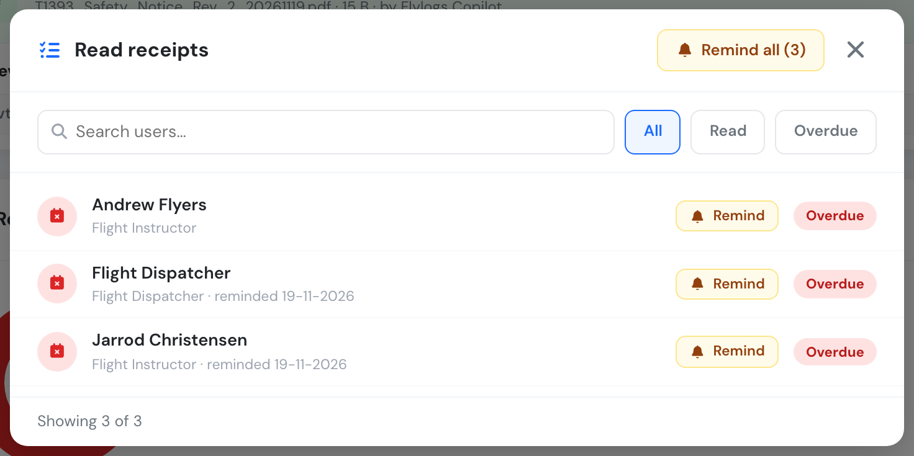
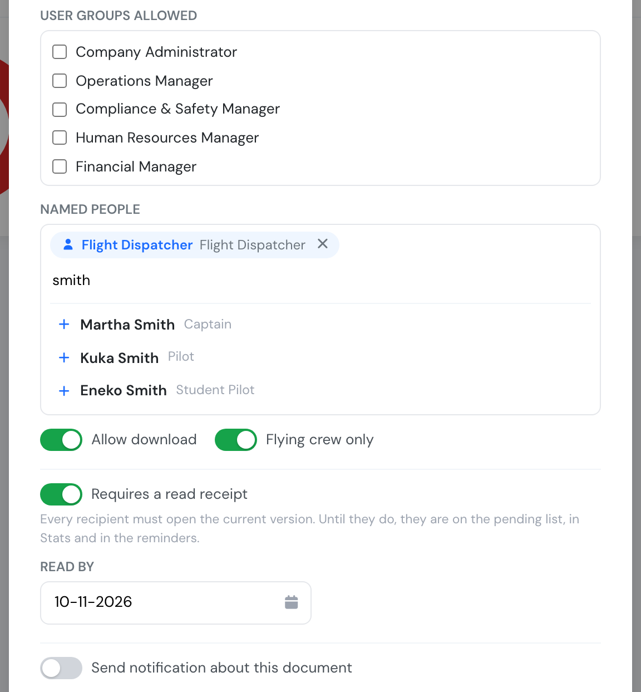

# New: Read receipts you choose, read-by dates and reminders

**November 2026** · Documents



The Document Library now lets you decide which documents need a read receipt, give a document a date by which it must be read, address it to specific people, and chase the people who have not read it — with a button, or automatically twice a month.

***

### Why we built it

Every document used to request a receipt from everyone it was published to, with no way to switch that off. Reference material — aircraft manuals, posters, textbooks — filled the pending lists and pulled the compliance figure down, though nobody expected anyone to acknowledge it. Nothing made a receipt late rather than merely outstanding, nothing chased anybody after the first notification, and an instruction for four people had to be published to a whole group.

***

### How it works

* **Requires a read receipt, per document.** On by default and on for every existing document, so no figure changes by itself. Switch it off on reference material: it stays available to its recipients but leaves the pending list, the Stats page and the reminders.
* **Read-by date.** Give a document a date. Once it has passed, everyone who has not opened the current version is **overdue**, in red on the document list, the document page and the Stats page. A new version resets everyone to unread, so you can set a fresh date when you upload it.

<figure><figcaption>
A safety notice past its read-by date, with the Remind all button.
</figcaption></figure>

* **Reminders from the pending list.** **Remind all** messages everybody who has not read the current version; **Remind** next to a name messages one person. Each person shows when they were last reminded, and anyone reminded in the last 12 hours is skipped.

<figure><figcaption>
The read receipts list with a Remind button per person.
</figcaption></figure>

* **Automatic reminder on the 1st and 16th.** Switch it on under **Company Settings → General → Document library**. Each person with documents still to read gets one message listing them, overdue first. It stops as soon as they open the current version. Off by default.
* **Named people as recipients.** Next to the user groups, add specific people to a document. They see it, are notified and owe a receipt like group members — so an instruction for four people reaches only those four.

<figure><figcaption>
Named people, the read receipt switch and the read-by date on the document form.
</figcaption></figure>

* **Stats count what matters.** The [Document Stats](../documents/document-stats.md) page leaves out documents that require no receipt, counts named people, and shows how many pending receipts are overdue.

Reminders and the pending list are available to managers up to group level 150 (Chief Pilot); the Stats page to group level 145 and lower.

[Manual →](../documents/document-library.md#read-receipts-and-read-by-date)
