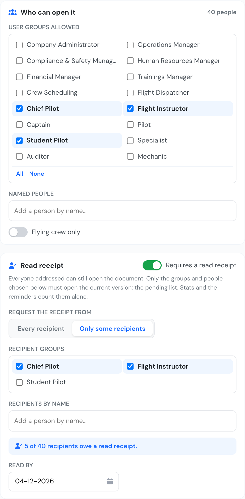
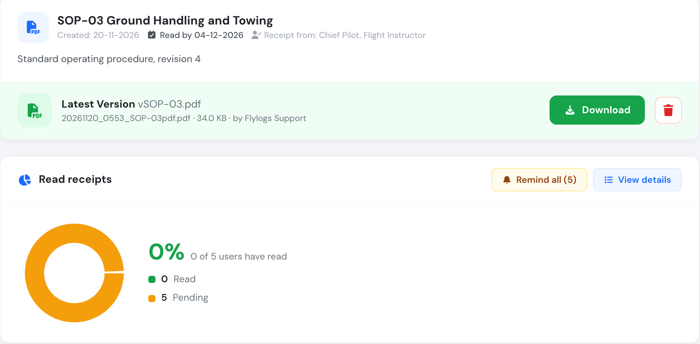

# New: Request a read receipt from some recipients only

**November 2026** · Documents

A document can now be open to everyone who needs to read it and acknowledged only by the people whose receipt matters. Who may open a document and who must acknowledge it are now two separate choices.

***

### Why we built it

The recipient list used to do both jobs. A standard operating procedure that every student pilot must be able to open asked every student for a receipt too, although the receipt only mattered from the instructors and the post holders. The only alternatives were to switch the receipt off for everyone, or to publish the same controlled document twice — and two copies of a manual drift apart.

***

### How it works

* **Request the receipt from.** With **Requires a read receipt** on, choose **Every recipient** (the default, and how every existing document stays) or **Only some recipients**, then tick the recipient groups and add the people by name the receipt is requested from.
* **A live count.** The form shows how many of the recipients owe a receipt before you save.

<figure><figcaption>
Open to student pilots, chief pilots and instructors; receipt requested from chief pilots and instructors.
</figcaption></figure>

* **One pool everywhere.** The pending list, the Remind buttons, the automatic reminder on the 1st and 16th and the [Document Stats](../documents/document-stats.md) page all count only the people the receipt is requested from. The document page says who they are.
* **Nothing taken away from the readers.** Everyone addressed still opens the document and is told about new versions, and their reads still appear in the download registry. They simply are not marked **Unread** or chased for a receipt.

<figure><figcaption>
Published to 40 people, receipt requested from 5.
</figcaption></figure>

Available to managers up to group level 150 (Chief Pilot), on the New Document and Edit Document forms and in the API (`DocumentReceiptFrom`).

[Manual →](../documents/document-library.md#request-the-receipt-from-some-recipients-only)
