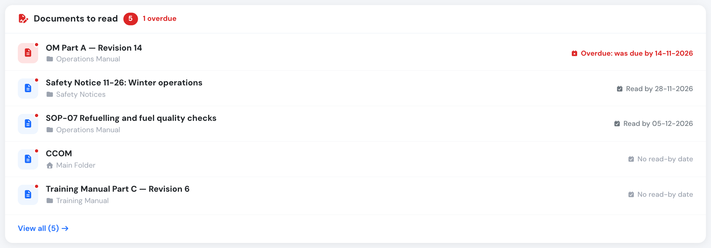
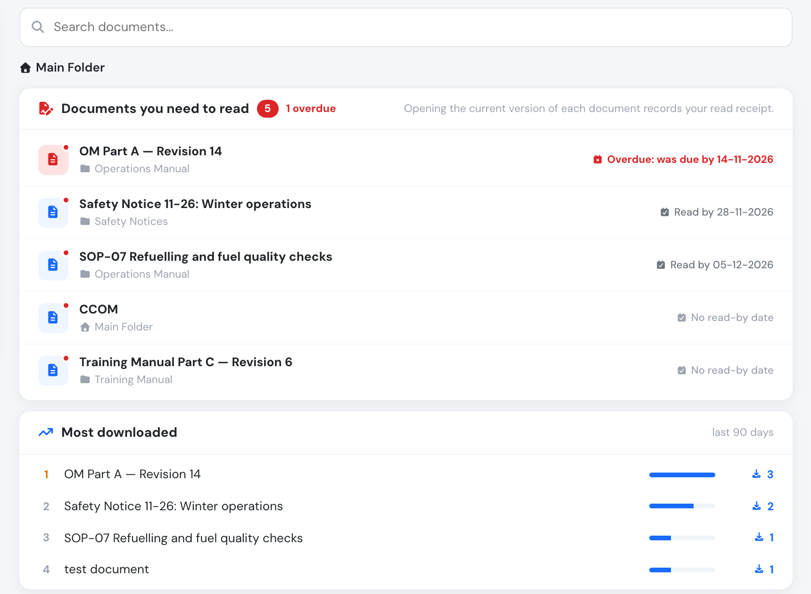

# New: See the documents you still have to read

**November 2026** · Documents

Flylogs now shows each person, in one place, the documents they still owe a read receipt for: on the dashboard, at the top of the Document Library and as a count on the Documents menu item. Until now, the reminder email on the 1st and 16th was the only list; inside the app, people had to open every folder and look for the **Unread** marker.

***

### Why we built it

A read receipt is how an operator or training organisation shows that its personnel are aware of the procedures relevant to their duties. An obligation that only appears in an email twice a month is easy to miss, and managers end up chasing people who would have read the document had they simply seen it when they logged in.

***

### How it works

* **Dashboard.** Company Administrators, Operations Managers and Trainings Managers get a **Documents to read** chip in the **Needs attention** card, with the count and how many are overdue. Everyone else gets a **Documents to read** card under the welcome banner, overdue first, with each read-by date.

<figure><figcaption>
The Documents to read card on a pilot's dashboard.
</figcaption></figure>

* **Document Library.** The Main Folder view leads with **Documents you need to read**, from every folder, overdue first, with the folder and read-by date of each. **Most downloaded** follows.

<figure><figcaption>
The library opens with what you have to read.
</figcaption></figure>

* **Left menu.** The **Documents** item shows how many documents you have to read, like Flights, Trainings and Safety.
* **One rule everywhere.** A document is listed when it requires a read receipt, it is addressed to you, the receipt is requested from you and you have not opened its current version — the same rule as the **Unread** marker, Document Stats and the reminders. Opening the document takes it off the list.

Available to every user group. In the API: `GET /documents/to_read.json`, and `documents_to_read` in `GET /users/badges.json`.

[Manual →](../documents/document-library.md#documents-you-need-to-read)
