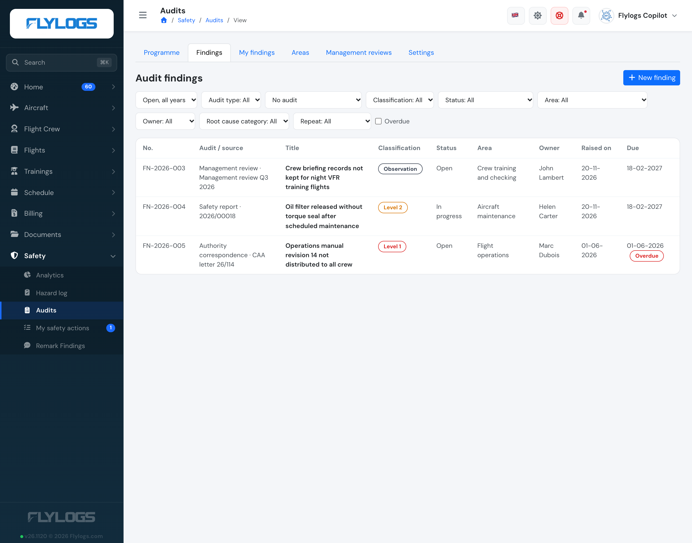
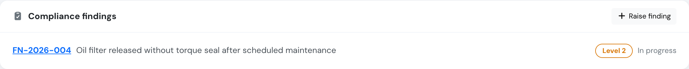

# New: Findings without an audit, and raised from a safety report

**November 2026** · Safety

Every compliance finding now has one register, whatever found it. A finding no longer needs an audit, each finding records where it came from, and a finding can be raised straight from a safety report or moved to another audit.

***

### Why we built it

Findings could only be recorded on an audit. A non-compliance found while investigating an occurrence, during a management review or in the authority's correspondence had to be filed against an audit it did not come from, or kept outside Flylogs. Neither gives the compliance monitoring manager one list of open findings to follow up and report on.

***

### How it works

* **No audit.** On the new-finding form choose **No audit** and say where the finding came from. It gets a classification, an owner, due dates and corrective actions like any other finding, and is numbered in the company series **FN-YYYY-NNN**.
* **A source on every finding.** **Audit**, **Safety report**, **Management review**, **Authority correspondence** or **Other**, with an optional reference such as the report number or the authority's letter. The findings list shows it in the **Audit / source** column and can be filtered by it.

<figure><figcaption>
Findings from an audit, a management review, a safety report and the authority in one list.
</figcaption></figure>

* **Raise finding from a safety report.** On a submitted report, **Manage > Raise finding** opens the form with the report as the source, and the report is linked to the finding. The report's new **Compliance findings** box lists the findings raised from it.

<figure><figcaption>
The Compliance findings box on a safety report.
</figcaption></figure>

* **Move a finding to another audit.** Edit the finding and choose another audit, or **No audit**. The finding takes the next number of its new series and the history keeps the old one.
* **Counted everywhere.** These findings count in their area's open findings and appear in the management report, the reminders, the Safety Assurance dashboard and All safety actions. They are internal: authority statuses and decisions stay with the findings of an authority audit.

Available to managers on the **Premium** and **Unlimited** plans. Auditors keep working on the findings of the audits they conduct. In the API, `audit_id` is optional on `audit_findings/add.json`, with the new `source`, `source_ref` and `safety_report_id` fields.

[Manual →](../sms/audit-findings.md#findings-without-an-audit)
