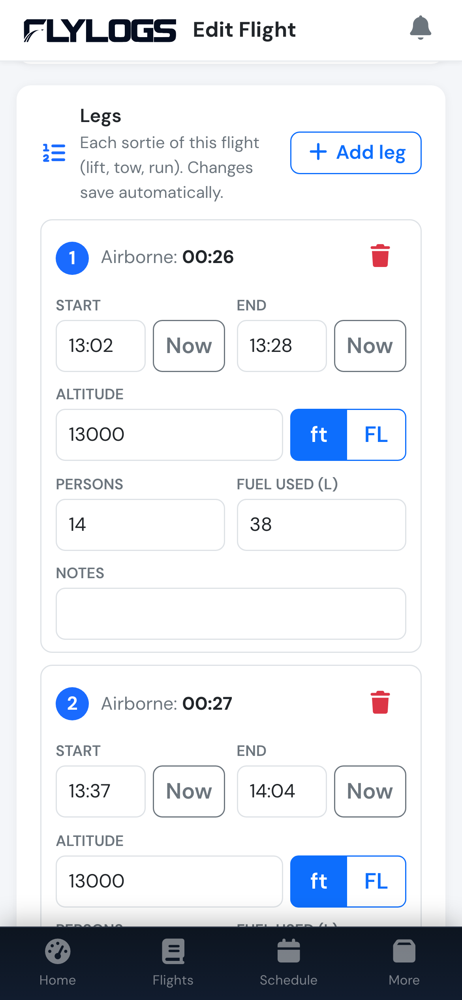
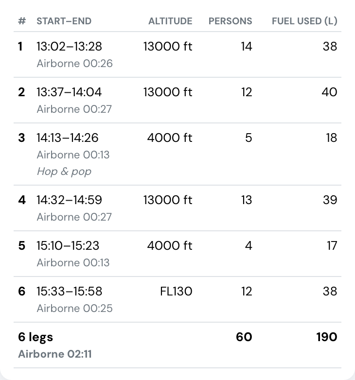

# New: flight legs

**November 2026** · Flights

Skydiving lifts, glider and banner tows, survey runs: some flights are many short sorties. Until now every sortie went into Remarks as free text. **Flight legs** give each sortie its own row, with the same columns for every operation: start and end (one tap on **Now**), airborne time worked out for you, altitude in feet or flight level, persons, fuel used and notes.



***

### Made for the cockpit

<figure><figcaption>
The Legs card on a phone.
</figcaption></figure>

* **Every change saves on its own**, with a short confirmation. No Save button.
* **No signal?** The leg is saved offline and sent as soon as the device is back online.
* **The next leg repeats the last one**: altitude, unit and persons are filled in, so a lift usually takes two taps on **Now**.
* **Deleted by mistake?** Tap **Undo**.
* Large buttons and number keypads on iPhone and iPad.

Legs never change the flight's own block times, landings or fuel, and **Remarks** is still there for anything else.

### Everywhere the flight goes

<figure><figcaption>
Six lifts of one flight, with totals.
</figcaption></figure>

* The **flight page** shows a Legs table with totals.
* The **flight PDF** prints the legs before the remarks.
* The **logbook export (XLS)** adds a **Legs** sheet and a **Legs by day** summary: lifts, jumpers and airborne time per day and aircraft.
* On **confirmed** flights, leg changes appear in the flight's change history.

### Who can use it

Flight legs are on every paid plan (Club, Premium, Unlimited) and during the 30-day trial. Whoever can edit a flight can edit its legs.

[Flight legs in the manual →](../flights/flight-legs.md) · [API →](../API/flight-legs.md)
