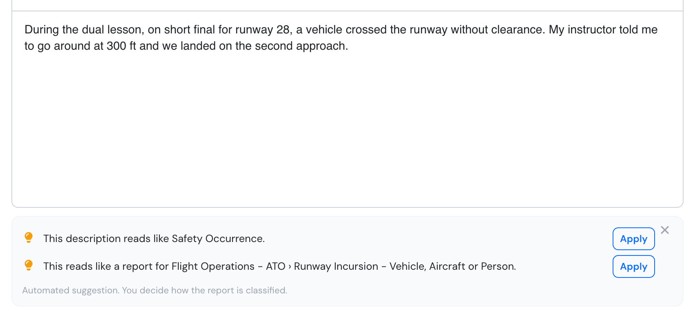
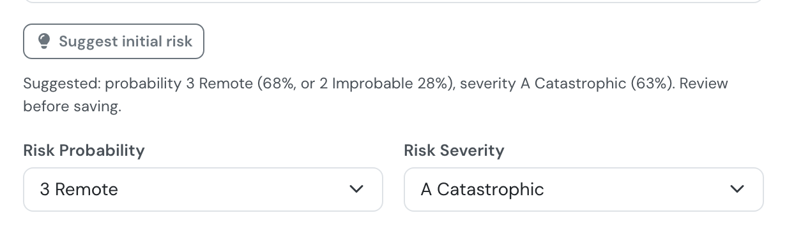
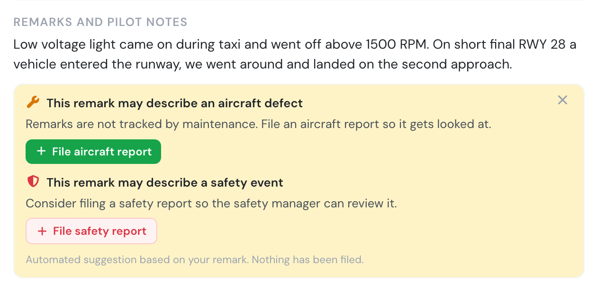
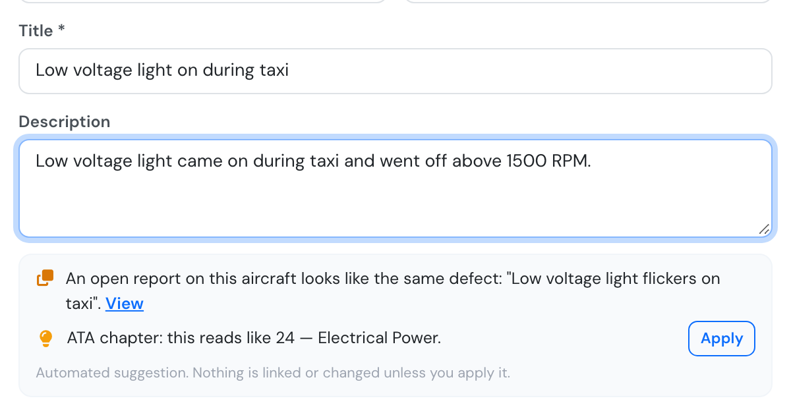
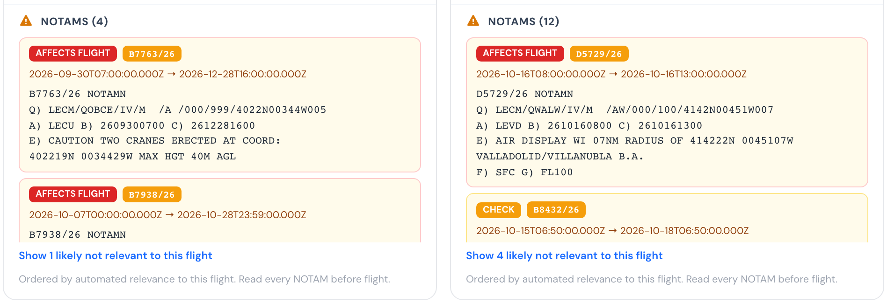
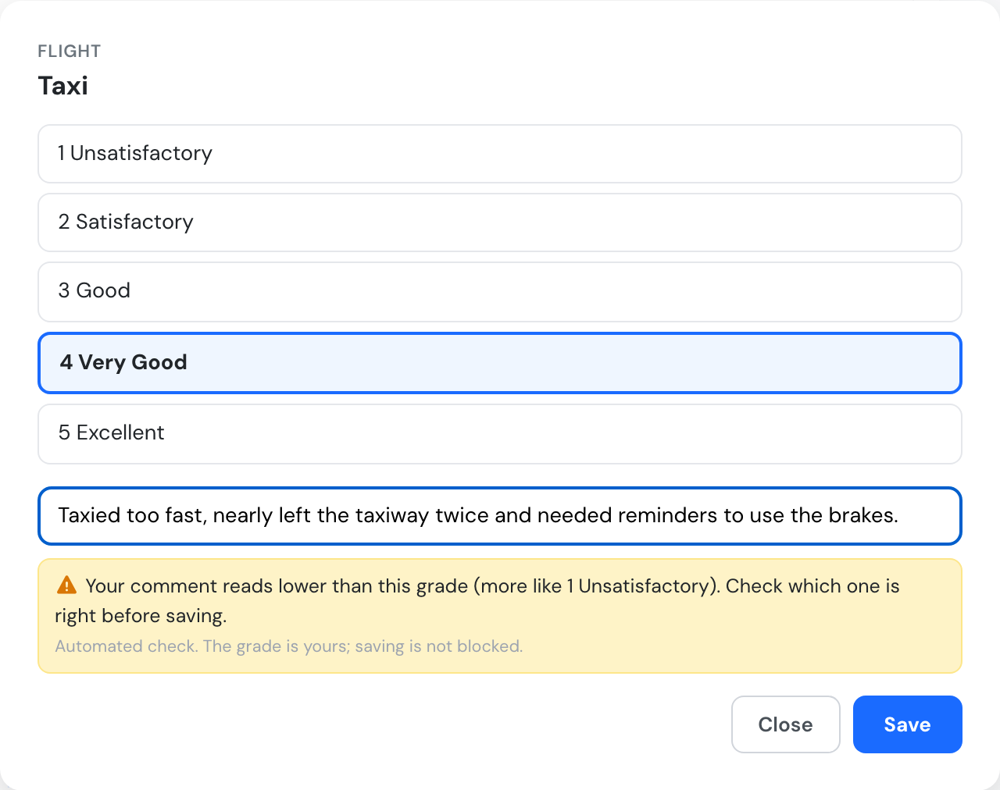
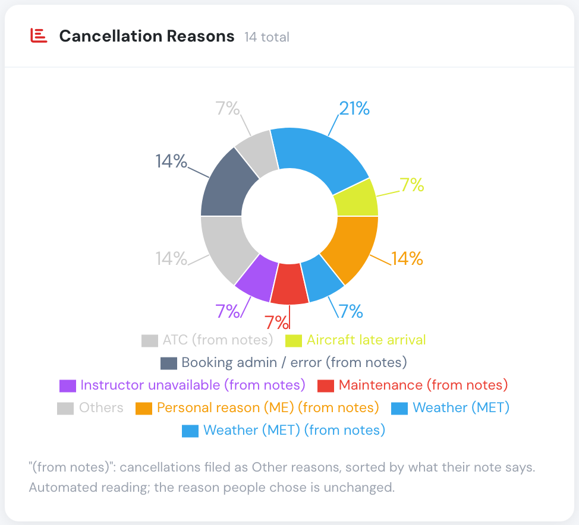
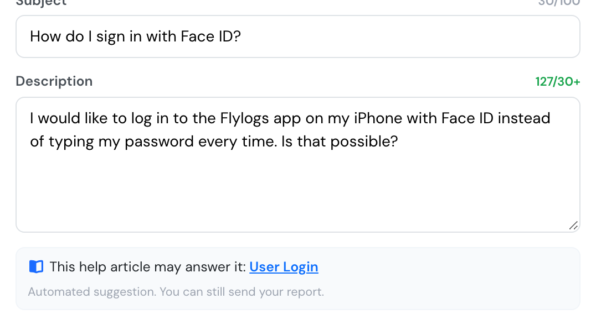

# New: suggestions while you work

**October 2026** · Safety, Maintenance, Schedules, Trainings, Support

Flylogs now reads what you write in a few key places and suggests the next step: the right classification for a safety report, the report a flight remark deserves, the ATA chapter of a defect, which NOTAMs matter for your flight, a grade that contradicts its comment, and the real reasons behind "Other" cancellations.

Every one of them is a suggestion. **Nothing is filed, saved, linked or changed until you click it**, and every hint says it is automated. They appear only while you are online.

***

### Filing a safety report



As you describe the event, Flylogs suggests the classification (Safety Occurrence or Safety Information), the department, the ICAO occurrence category and the phase of flight — only where they differ from what is selected. One click applies each.

<figure><figcaption>
Suggestions under the description of a new safety report.
</figcaption></figure>

Safety managers get a **Suggest initial risk** button in Report Management: a starting probability and severity, with how sure it is.

<figure><figcaption>
A suggested initial risk, waiting for the manager to save.
</figcaption></figure>

[Create a safety report →](../sms/create-a-safety-report.md#classification-suggestion) · [Risk matrix →](../sms/icao-8951-risk-matrix.md)

### From a flight remark to the right report



When a remark you just wrote reads like a defect or a safety event, the flight page offers the matching form, pre-filled with the remark.

<figure><figcaption>
One remark, two reports offered.
</figcaption></figure>

While you write a defect, the aircraft report form suggests the ATA chapter and points out an open report on the same aircraft that already describes it.

<figure><figcaption>
The same light was reported three days ago, and the ATA chapter is ready to apply.
</figcaption></figure>

[Flight remark findings →](../sms/flight-remark-findings.md#hints-on-the-flight-page) · [Aircraft reports →](../aircraft/aircraft-maintenance/aircraft-reports.md#hints-while-you-write-a-defect)

### NOTAMs ranked for your flight



The briefing puts the NOTAMs that affect your flight first and folds away the ones that clearly don't — never removing them. Read every NOTAM before flight.

<figure><figcaption>
Departure and arrival NOTAMs, most relevant first.
</figcaption></figure>

[Flight dispatch →](../schedules/flight-dispatch-function.md#notams-ranked-for-your-flight)

### Grade and comment check



When an instructor's comment on an exercise tells a different story from the grade, the grading window warns before saving. The grade stays the instructor's.

<figure><figcaption>
A comment that reads lower than the grade picked.
</figcaption></figure>

[Draft a mission comment →](../flights/draft-mission-comment.md#grade-and-comment-check)

### Cancellation reasons from notes



Bookings cancelled as "Other reasons" now count under the reason their note gives, marked **(from notes)**. The reason people chose is never changed.

<figure><figcaption>
"Others" split into its real reasons.
</figcaption></figure>

[Schedule cancellations →](../schedules/schedule-cancellations.md)

### Help before you report



While you write to Flylogs support, the form suggests a help article that may already answer your question, and an open ticket describing the same problem, which you can follow instead of filing a new one. You can always still send your report.

<figure><figcaption>
A help article suggested while writing to support.
</figcaption></figure>

***

### Who sees what

| Suggestion | Who |
|---|---|
| Safety report classification, department, category, phase | Anyone who can create a safety report |
| Suggest initial risk | Managers (user group 110 and below) and the report's assigned reviewer |
| Remark hint on the flight page | The crew of that flight and managers; flights logged in the last 7 days |
| Defect hints (ATA, open report, open job) | Anyone who can file an aircraft report |
| NOTAM ranking | Everyone who can open the booking or flight |
| Grade and comment check | Flight Instructors and above |
| Cancellation reasons from notes | Whoever can open the Cancellations page |
| Help before you report | Everyone |
