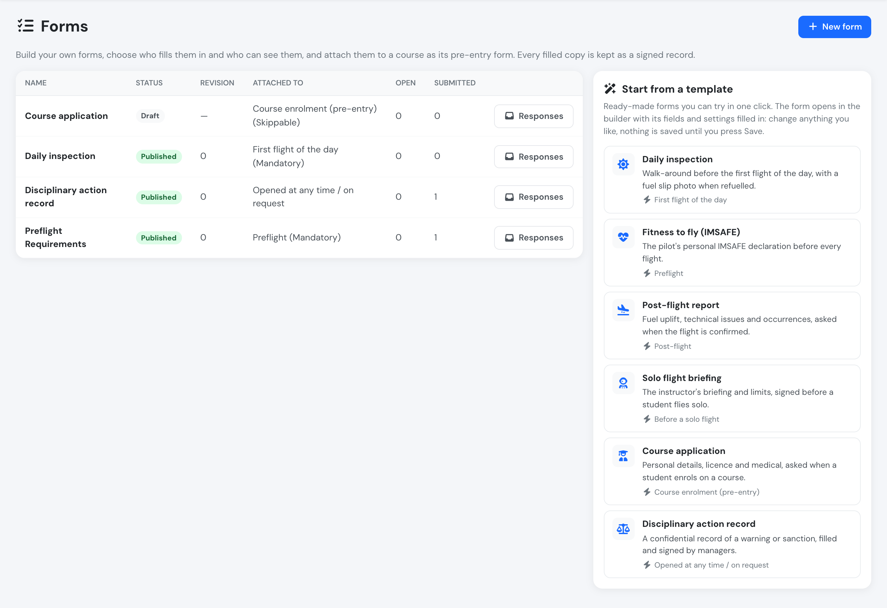
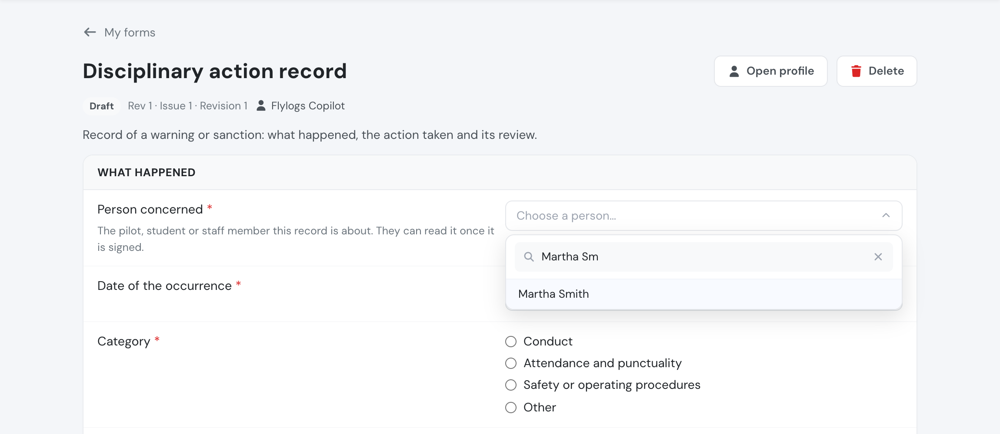
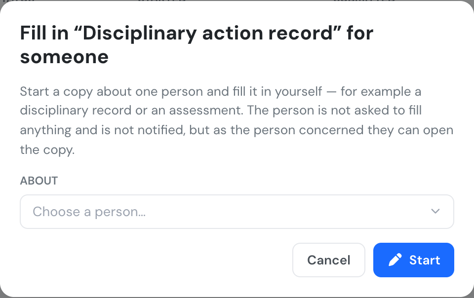

# New: form templates, person fields and filling in for someone

**November 2026** · Company management

Custom forms now come with ready-made templates: one click opens a complete form in the builder, ready to review and publish. A new Person field lets a form say who it is about, and you can start a copy about a person and fill it in yourself, for records such as a disciplinary action.

***

### Start from a template

**Home → Forms** now has a **Start from a template** panel. Click a template and the builder opens with its fields, conditions, who fills it and what it is attached to already set up. Nothing is saved until you press **Save**, so you can open a template just to see how it is built.

<figure><figcaption>
The templates sit next to your forms.
</figcaption></figure>

Six templates are available: Daily inspection, Fitness to fly (IMSAFE), Post-flight report, Solo flight briefing, Course application and Disciplinary action record. Their text appears in your language, and once saved the form is yours to change like any other.

***

### Person fields

A new **Person** field type lists your company's users, filtered by user group. Tick **This is who the form is about** and the person chosen becomes the person the copy is about: they show in the responses list and can read the signed copy under **My forms**. The Disciplinary action record template starts with one, *Person concerned*.

<figure><figcaption>
Choosing who the record is about.
</figcaption></figure>

***

### Fill in a form for someone

Some forms are about a person but are filled in by a manager, such as a disciplinary record or an assessment. **Forms → Responses → Fill in for someone** starts a copy about the person you choose and opens it for you to fill in and sign. The person is not asked to fill anything and gets no notification. Once the copy is signed, they can read it under **My forms**.

<figure><figcaption>
Choose the person, then fill in and sign the copy.
</figcaption></figure>

***

See [Custom forms](../company-management/custom-forms.md#starting-from-a-template) for the full reference.
