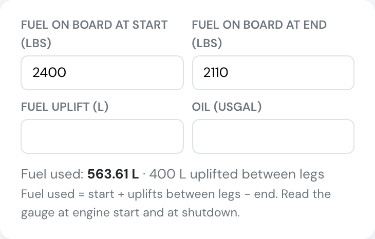
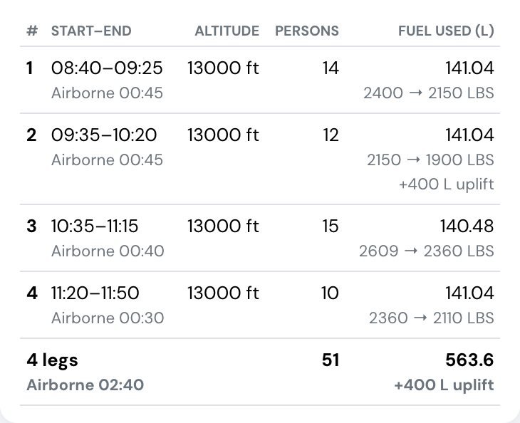
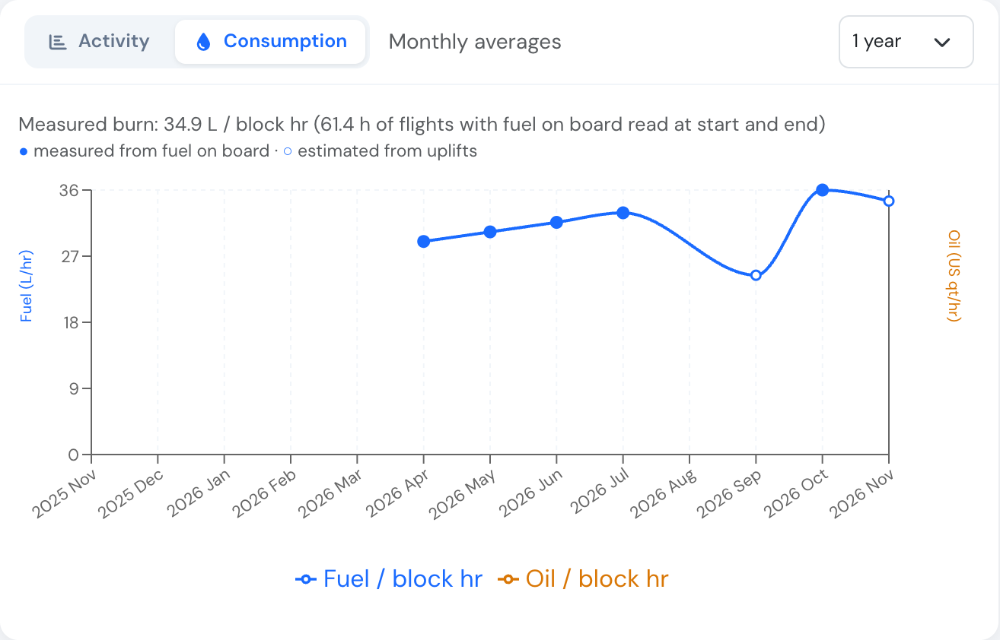
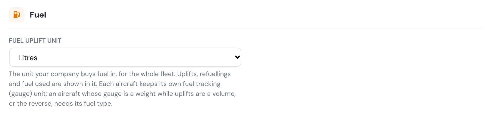

# New: fuel used, worked out from the gauge

**November 2026** · Flights

Pilots read the fuel gauge and know what went into the tank. Fuel used is arithmetic, so Flylogs now does it for them:

> **Fuel used = fuel on board at start + fuel uplifted between legs − fuel on board at end**

***

### On every flight

Aircraft that track fuel get two new fields on the flight form: **Fuel on board at start** and **Fuel on board at end**, read at engine start and shutdown. Fuel used appears under them as you type, and on the flight page, the flight PDF and the logbook export.

### Uplifts between legs

For flights with [legs](../flights/flight-legs.md) — skydiving lifts, tows, survey runs — each leg now records the **fuel uplifted after it**: "after leg 3, 400 litres". Fuel on board at a leg's start and end is optional, and gives that leg its own fuel used. A new leg pre-fills its start fuel from the previous leg's end plus the uplift.

Every uplift after a leg is added to the flight's refuelling on **Billing → Fuel & Excise**, so nothing is typed twice.

<figure><figcaption>
The fuel card on the flight form: gauge readings in pounds, fuel used worked out in litres.
</figcaption></figure>

<figure><figcaption>
On an aircraft that tracks fuel, the Fuel used column carries each leg's gauge readings and the uplift after it.
</figcaption></figure>

### Better statistics

<figure><figcaption>
The Consumption tab on the aircraft page. Filled dots are measured from fuel on board, hollow dots estimated from uplifts.
</figcaption></figure>

* The aircraft's **Consumption** chart shows the fuel actually burned per hour for every month whose flights have start and end readings, instead of an estimate from uplifts.
* The **consumption check** on Fuel & Excise compares aircraft on measured burn once they have 10 hours of readings.
* The **aircraft logbook export** gains Fuel start, Fuel end, Fuel uplift and Fuel used columns.
* The **cloud storage** flights file gains fuel on board at start and end.

### Pounds on the gauge, litres at the pump

Your company can now set an **uplift unit** in **Company Settings → Flights → Fuel**, separate from each aircraft's fuel tracking (gauge) unit: gauges in pounds refuelled in litres, for example. It is one setting for the whole fleet, because fuel is bought in the same unit whatever the aircraft. Set each such aircraft's **fuel type** too, so pounds convert to litres with the right density (Jet A-1 0.804 kg/l). Without it Flylogs says so instead of guessing.

<figure><figcaption>
One uplift unit for the whole fleet.
</figcaption></figure>

1,500 lb at start, 400 l uplifted after leg 1, 1,100 lb at end, Jet A-1: fuel used is **625.7 l**.

***

[Manual: Flight legs → Fuel](../flights/flight-legs.md#fuel)
