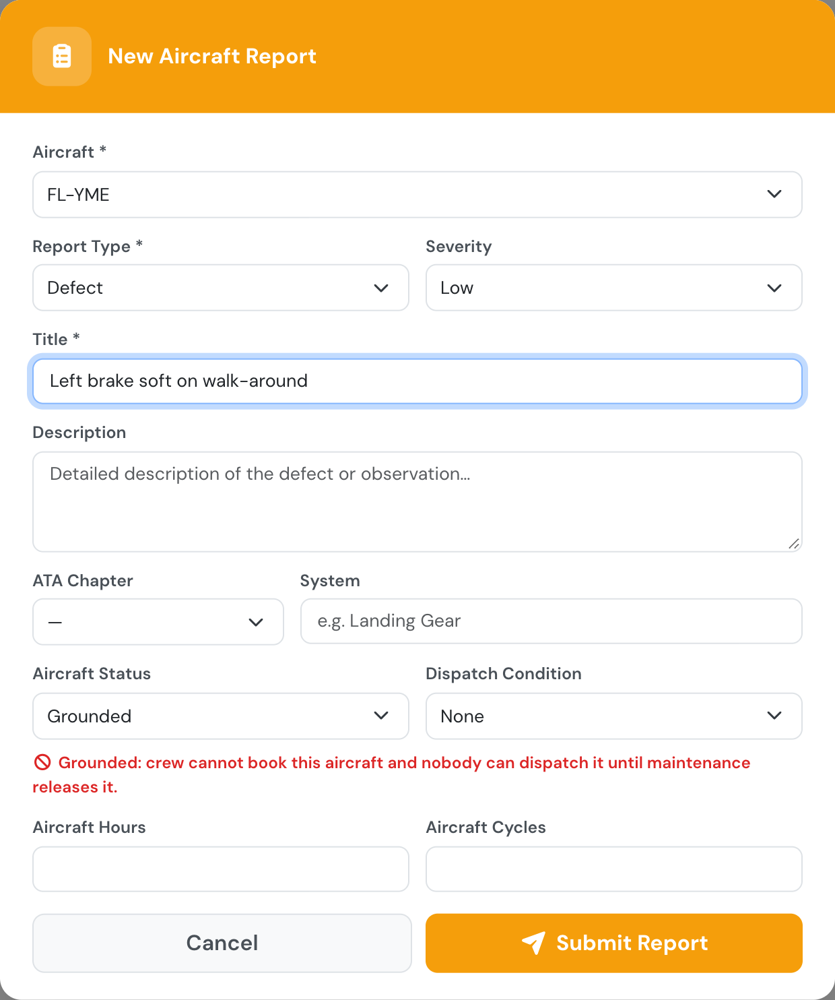
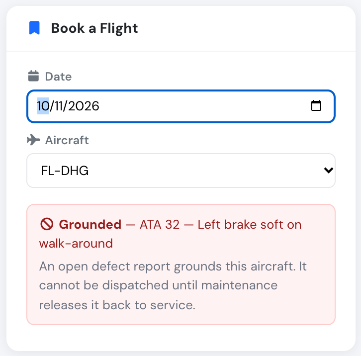

# New: grounded means grounded, and defects without a flight

**November 2026** · Fleet & Maintenance

Marking a defect report **Grounded** now takes the aircraft out of service. Crew cannot book it and nobody can dispatch it until maintenance releases it. Any pilot can also report a defect straight away, with no flight log entry.

***

### Why we built it

Until now, **Grounded** on an aircraft report was a label. It appeared on the report and in the message to managers, but the aircraft stayed bookable and could still be dispatched. A club had to rely on everyone reading their messages before booking.

Reporting the defect was a problem too. Pilots and students could only file a report from a logged flight, so a defect found on the walk-around or on a parked aircraft meant inventing block and flight times first.

***

### How it works

**Report defect** is now on the Flights page, on every booking, in the dispatch window and on the aircraft page. It opens the usual report form with no flight attached. Everyone can use it.

<figure><figcaption>
No flight, no block times: pick the aircraft and describe the defect.
</figcaption></figure>

While an open report marks the aircraft **Grounded**:

* pilots, instructors and students cannot book it, and the slot finder says why,
* nobody can dispatch it, managers included,
* managers and maintenance staff can still book it, with a warning, to plan the flights after the repair,
* the message managers receive lists the bookings already on the aircraft (nothing is cancelled automatically),
* the fleet list and the aircraft page show it as grounded.

<figure><figcaption>
Crew see why the aircraft cannot be booked.
</figcaption></figure>

Only maintenance staff (Company Administrators, Operations Managers, Compliance & Safety Managers, Mechanics) and the aircraft's managers can release it: set the report back to **Flyable**, close it, or sign the CRS of its maintenance job.

See [Aircraft reports](../aircraft/aircraft-maintenance/aircraft-reports.md) for details.
