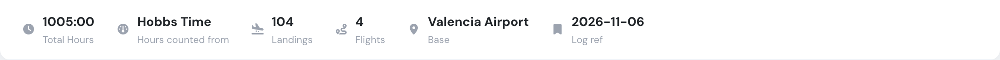
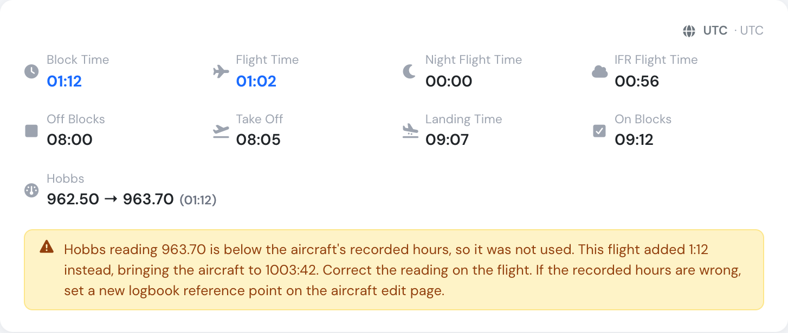

# New: see what your aircraft hours follow

**November 2026** · Fleet & Maintenance

The aircraft page now shows which clock counts the aircraft's hours, right next to the total. Flylogs also tells you when a Hobbs reading was not used, and why.

***

### Hours counted from

**Hours counted from** now sits beside **Total Hours**. It shows flight time, block time, tach time or Hobbs time. An aircraft can record a Hobbs reading on every flight while its hours follow block time, and now you can see that at a glance.

<figure><figcaption>
Hours counted from, next to the total.
</figcaption></figure>

***

### A warning when a Hobbs reading is not used

On an aircraft counted on Hobbs time, a reading lower than the recorded hours is not used, so a mistyped value cannot wind the hours back. Until now this happened without any message.

The flight now shows a warning triangle in the aircraft logbook and an explanation on the flight page. It gives the reading, what the flight added instead, and how to correct it.

<figure><figcaption>
The explanation on the flight page.
</figcaption></figure>

Everyone who can open the aircraft or the flight sees both. Nothing is recalculated: the warning only explains what is already in the logbook.

***

See [Aircraft logbook](../aircraft/aircraft-logbook.md#which-clock-counts-the-hours) for the full reference, including how to make an aircraft's hours follow its meter.
