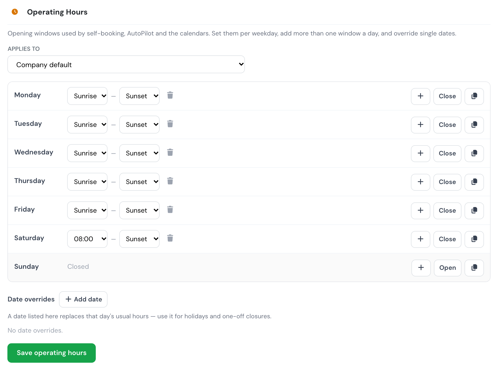

# New: Sunrise and sunset operating hours

**October 2026** · Company settings & Schedules

Operating hours no longer have to be a clock time. Each opening or closing time can now be **Sunrise** or **Sunset**, so a field that flies in daylight keeps the right hours all year without anyone editing them.

***

### Why we built it

Many operations are limited by daylight rather than by the clock. A fixed `08:00–18:00` is wrong for half the year: too early to fly in winter, too early to close in summer. Until now the only fix was to change the hours by hand every few weeks.

***

### How it works

Open **Company Settings → Schedule → Operating Hours**. Every opening and closing time is a drop-down: pick a clock time, **Sunrise** or **Sunset**. You can mix them, for example **08:00** to **Sunset**.

<figure><figcaption>
Monday to Friday follow the daylight, Saturday opens at 08:00 and closes at Sunset, and Sunday is closed.
</figcaption></figure>

* **Local to the base.** Sunrise and sunset are worked out for the **airport of the base** the hours apply to, and shown in your company timezone. A company with several bases gets the right times for each one.
* **Civil twilight.** Sunrise is the start of civil twilight and sunset is its end (the sun 6° below the horizon).
* **One value per week.** The times of the Monday are used for the whole week, so a window does not shift from one day to the next.
* **Safe by default.** If the base has no airport set, or the sun never reaches that angle (polar day or night), the window stays **open all day** rather than closing your operation. The editor warns you when a base has no airport position.
* **No impossible combinations.** Flylogs will not save hours that would, at any time of the next year, close a window before it opens or make two windows overlap. The editor tells you the day and week where it breaks.

***

### Where you'll see it

* **Self-booking.** Only slots inside the daylight window are offered, and a booking outside it is refused.
* **Schedule Manager.** A booking outside the window shows a warning, using the local sunrise and sunset of the base. Managers can still book outside operating hours on purpose.
* **AutoPilot and the calendars.** Missions are only placed inside the window, and the calendars are drawn to it.

See [Company Settings → Schedule](../company-management/company-settings/schedule.md#operating-hours) for the full reference and [Company API → Operating hours](../API/company.md#operating-hours) for the `SUNRISE`/`SUNSET` fields.
