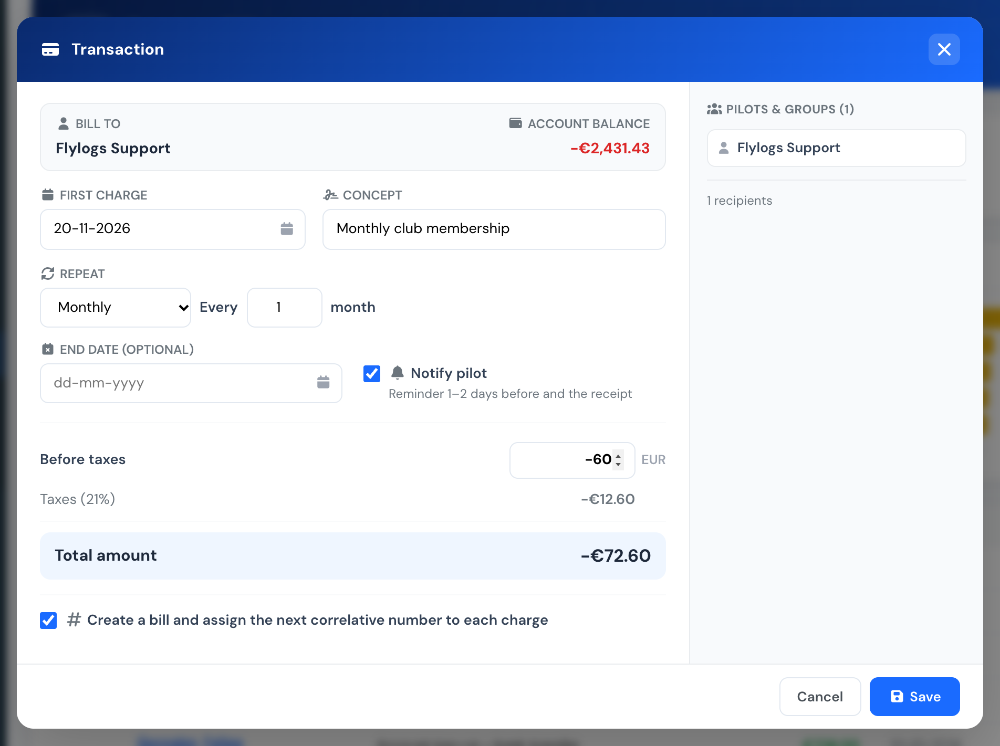
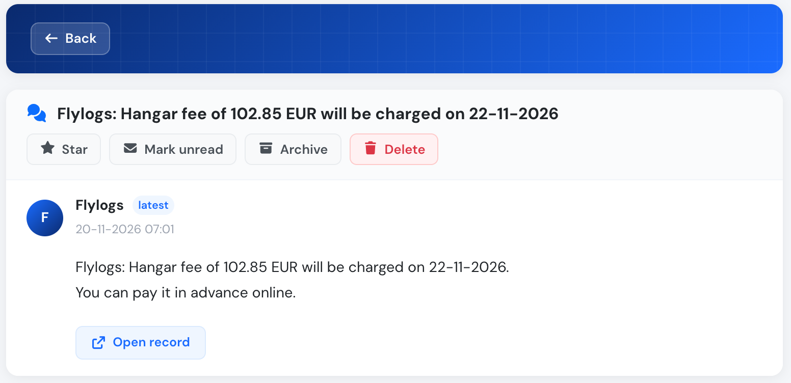
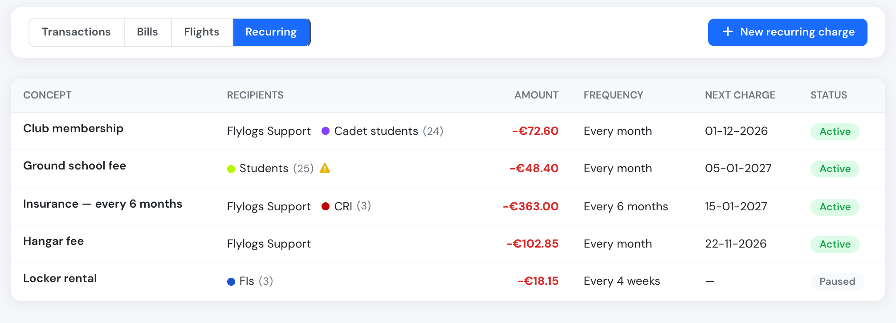

# New: recurring transactions

**November 2026** · Billing

Charges that come back every week, month or year, such as club membership, hangar fees or insurance, can now be set up once. Flylogs posts them to your pilots on every due date, reminds them beforehand and sends the receipt.

***

### Set it once

In **Add Transaction**, set **Repeat** to **Monthly**, **Weekly** or **Yearly** and enter how many months, weeks or years go between charges (1 to 24), then the first charge date and, if you want, an end date. You can charge pilots, pilot groups, or both. A group is read again on each due date, so new members are charged from the day they join.

<figure><figcaption>
Add Transaction with Repeat set to every month.
</figcaption></figure>

Each charge is posted as a normal transaction in the pilot's account, with a bill number if you want one, and marked with a recurring icon.

***

### Reminders before, receipt after

With **Notify pilot** on, each pilot gets a reminder between 24 and 48 hours before the charge, and the receipt when it is posted. If your company takes card payments, the reminder says the charge can be paid in advance online, and its link opens the payment window; the receipt email has a **Pay now** button when the pilot owes money.

<figure><figcaption>
The reminder in the pilot's inbox.
</figcaption></figure>

***

### Manage them in one place

The new **Recurring** view in the manager **Bills** page lists every recurring transaction with its recipients, amount, frequency, next charge and status. Open one to change it, pause it, resume it or delete it. Resuming never charges the paused period, and deleting keeps the transactions already posted.

<figure><figcaption>
The Recurring view.
</figcaption></figure>

***

### Receipts follow the kind of bill

Receipts now follow the kind of bill, and the company-wide switch for emailing new bills is gone. Automatic flight bills (also when recalculated after a flight edit) and prepaid package purchases now always email the receipt. For manual flight bills, **Send notification** decides; for manual transactions, **Send this receipt to the user** decides; online card payments always send the receipt.

***

See [Recurring transactions](../billing/billing-setup.md#recurring-transactions) for the full reference.
