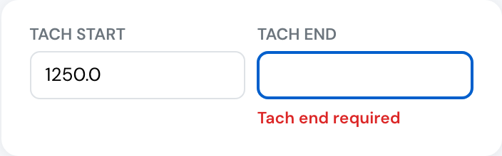
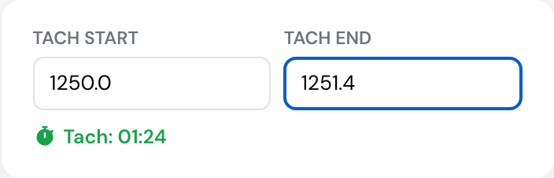

# New: billing on the meter you actually read

**November 2026** · Billing & Flights

When an aircraft bills on tach or Hobbs time, the flight form no longer fills in the end reading for you. The pilot enters the reading from the aircraft, and the bill charges exactly the difference between start and end.

***

### The end reading comes from the aircraft

For an aircraft that bills on tach time, **Tach end** stays empty until the pilot types the reading. The same applies to **Hobbs end** on an aircraft that bills on Hobbs time. Before, the form estimated the end reading from the block time. If nobody corrected it, the customer was charged block time instead of meter time.

Both readings are now required on these aircraft once the flight has flown, and a reading of 0 is not accepted. Without both readings a flight cannot be billed, so the form asks for them before saving.

<figure><figcaption>
The end reading is required on an aircraft billed on tach time.
</figcaption></figure>

**Tach start** is still filled in from the end reading of the aircraft's last flight.

***

### Decimal comma accepted

Readings can be typed with a decimal comma. `1251,4` becomes `1251.4` as you type, so pilots using Dutch, German, Spanish or other keyboards no longer get an error.

<figure><figcaption>
1251.4 − 1250.0 = 1.4 hours (01:24) billed at the aircraft's hourly rate.
</figcaption></figure>

***

### Example

Tach start 1,250.0, tach end 1,251.4: the customer is billed 1.4 hours at the aircraft's hourly rate, whatever the booking length or block time.

Aircraft billed on block time or flight time work as before, and so do tach and Hobbs readings on aircraft that do not bill on them.

***

See [Create a flight](../flights/create-a-flight.md#hobbs-and-tach-readings) and [Aircraft permissions, rental and billing](../aircraft/create-your-aircraft.md#aircraft-permissions-rental-and-billing) for the full reference.
